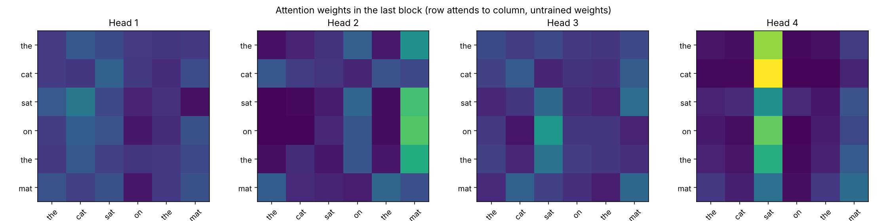

# Transformer from scratch: how it works inside and how to change it

A transformer encoder block in about 100 lines of NumPy, written to be read line by line.

```bash
pip install numpy matplotlib
python tiny_transformer.py
```

The weights are random, so the model has learned nothing. The point is to follow the shapes and the maths.

## What happens inside

| Step | What it does | Equation |
|---|---|---|
| 1. Tokenize | Text becomes token ids | |
| 2. Embed | Each id becomes a vector of size `d_model` | `x = E[id]` |
| 3. Add positions | Attention ignores order, so position is added to the vector | `x = x + PE(pos)` |
| 4. Self-attention | Every token builds a query, key and value. Queries are compared with all keys, and the scores decide how much of each value to take | `Attention(Q,K,V) = softmax(Q K^T / sqrt(d_k)) V` |
| 5. Multi-head | Step 4 runs in several heads in parallel, each with its own weights, then the results are joined | |
| 6. Add and norm | The input is added back (residual) and normalised, which keeps training stable | `x = LayerNorm(x + Attention(x))` |
| 7. Feed-forward | A small two-layer network applied to each token separately | `FFN(x) = W2 * ReLU(W1 * x)` |
| 8. Stack | Steps 4 to 7 form one block. A model stacks many blocks | |
| 9. Output | The final vectors are turned into a score for every vocabulary word | `softmax(x E^T)` |

`tiny_transformer.py` follows these steps in the same order.



## How to change a transformer

There are four levels, from the smallest change to the largest.

| Level | What you change | When to use it | In this repo |
|---|---|---|---|
| 1. Task head | Replace the output layer, for example a classifier instead of next-word scores | Using a pretrained model for a new task | Replace `logits = x @ E.T` |
| 2. LoRA | Freeze the weights and train two small matrices per layer: `W' = W + B A` | Limited compute. Trains about 2% of the numbers in a 768 x 768 layer at rank 8 | `lora_demo()` |
| 3. Fine-tuning | Keep the architecture, continue training all the weights on your data | You have labelled data and enough compute | Not included (needs a training loop) |
| 4. Architecture | `d_model`, number of heads, number of layers, feed-forward size, encoder or decoder masking | Building a new model, which then has to be trained from the start | Edit `Config`. Set `causal = True` for GPT-style masking |

You can also swap parts: learned positions instead of sinusoidal, GELU instead of ReLU, or normalising before attention instead of after (pre-norm), which most recent models use.

## Limits of this code

No training loop, no batching and no dropout. For real work use PyTorch or the Hugging Face `transformers` library. This file exists to make their internals readable.
